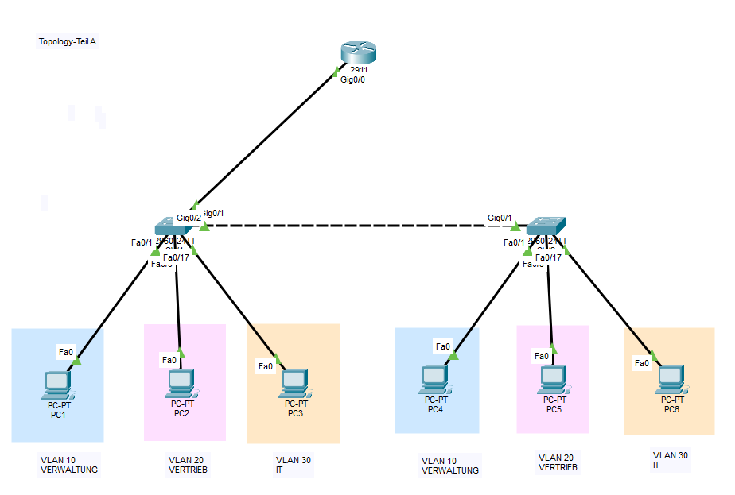
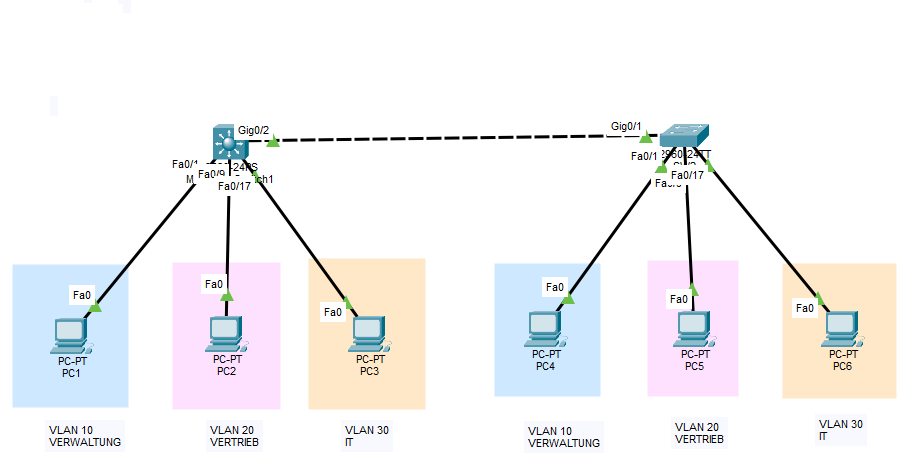

# Lab 01 – VLAN & Inter-VLAN-Routing

> **Summary (EN):** Small office network with three departments (Administration, Sales, IT) separated by VLANs on two Cisco 2960 switches connected via an 802.1Q trunk. Part A routes between the VLANs with Router-on-a-Stick (Cisco 2911); Part B migrates the same network to a Layer-3 switch (SVIs). Built and tested in Cisco Packet Tracer, including a deliberately introduced fault for troubleshooting practice.

> ℹ️ Dieses Lab basiert auf den Übungen meiner HTL-Ausbildung und meiner CCNA-Vorbereitung und wurde in Cisco Packet Tracer umgesetzt. Es handelt sich um eine Laborumgebung, nicht um ein produktives Netzwerk.

## Szenario

Ein kleines Büro mit drei Abteilungen: **Verwaltung**, **Vertrieb** und **IT**. Alle Abteilungen sollen voneinander getrennt sein (eigene Broadcast-Domain, Grundlage für spätere Sicherheitsregeln), aber trotzdem miteinander kommunizieren können. Zusätzlich gibt es ein eigenes **Management-VLAN**, über das die Switches erreichbar sind.

- **Teil A:** Inter-VLAN-Routing mit **Router-on-a-Stick** (ein Router, ein Trunk, mehrere Subinterfaces)
- **Teil B:** Migration auf einen **Layer-3-Switch** mit SVIs

## Topologie

**Teil A – Router-on-a-Stick:**


**Teil B – Layer-3-Switch:**


Verkabelung Teil A (in Teil B ersetzt MLS1 sowohl SW1 als auch R1, Ports bleiben gleich):

| Von | Port | Nach | Port | Typ |
|-----|------|------|------|-----|
| R1 (2911) | G0/0 | SW1 (2960) | G0/1 | Trunk (802.1Q) |
| SW1 | G0/2 | SW2 (2960) | G0/1 | Trunk (802.1Q) |
| PC1 / PC2 / PC3 | Fa0 | SW1 | Fa0/1 / Fa0/9 / Fa0/17 | Access |
| PC4 / PC5 / PC6 | Fa0 | SW2 | Fa0/1 / Fa0/9 / Fa0/17 | Access |

**Port-Plan auf beiden Switches:** Fa0/1–8 → VLAN 10, Fa0/9–16 → VLAN 20, Fa0/17–22 → VLAN 30, Fa0/23–24 ungenutzt (shutdown). Feste Port-Bereiche pro Abteilung machen die Konfiguration mit `interface range` einfach und die Zuordnung ohne Dokumentation nachvollziehbar.

## Adressierungsplan

Schema: `10.10.<VLAN-ID>.0/24` – das zweite Oktett steht für den Standort (10 = Wien), das dritte Oktett entspricht der VLAN-ID. Private 10.x-Adressen vermeiden Überschneidungen mit typischen Heimnetzen (192.168.x.x), z. B. bei VPN-Zugriff.

| VLAN | Name | Netz | Gateway |
|------|------|------|---------|
| 10 | VERWALTUNG | 10.10.10.0/24 | 10.10.10.1 |
| 20 | VERTRIEB | 10.10.20.0/24 | 10.10.20.1 |
| 30 | IT | 10.10.30.0/24 | 10.10.30.1 |
| 99 | MANAGEMENT | 10.10.99.0/24 | 10.10.99.1 |
| 999 | NATIVE | – (keine Hosts) | – |

| Gerät | Interface | VLAN | IP-Adresse | Subnetzmaske | Gateway |
|-------|-----------|------|------------|--------------|---------|
| R1 | G0/0.10 | 10 | 10.10.10.1 | 255.255.255.0 | – |
| R1 | G0/0.20 | 20 | 10.10.20.1 | 255.255.255.0 | – |
| R1 | G0/0.30 | 30 | 10.10.30.1 | 255.255.255.0 | – |
| R1 | G0/0.99 | 99 | 10.10.99.1 | 255.255.255.0 | – |
| R1 | G0/0.999 | 999 (native) | – | – | – |
| SW1 | VLAN 99 (SVI) | 99 | 10.10.99.11 | 255.255.255.0 | 10.10.99.1 |
| SW2 | VLAN 99 (SVI) | 99 | 10.10.99.12 | 255.255.255.0 | 10.10.99.1 |
| PC1 | Fa0 | 10 | 10.10.10.10 | 255.255.255.0 | 10.10.10.1 |
| PC2 | Fa0 | 20 | 10.10.20.10 | 255.255.255.0 | 10.10.20.1 |
| PC3 | Fa0 | 30 | 10.10.30.10 | 255.255.255.0 | 10.10.30.1 |
| PC4 | Fa0 | 10 | 10.10.10.11 | 255.255.255.0 | 10.10.10.1 |
| PC5 | Fa0 | 20 | 10.10.20.11 | 255.255.255.0 | 10.10.20.1 |
| PC6 | Fa0 | 30 | 10.10.30.11 | 255.255.255.0 | 10.10.30.1 |

## Umsetzung – Teil A: Router-on-a-Stick

### 1. Grundkonfiguration (alle Geräte)
```
hostname SW1
no ip domain-lookup
line console 0
 logging synchronous
```
- `no ip domain-lookup` verhindert, dass ein Tippfehler als Hostname interpretiert und per DNS gesucht wird.
- `logging synchronous` verhindert, dass Log-Meldungen die Eingabe unterbrechen.

### 2. VLANs anlegen (SW1 und SW2)
```
vlan 10
 name VERWALTUNG
vlan 20
 name VERTRIEB
vlan 30
 name IT
vlan 99
 name MANAGEMENT
vlan 999
 name NATIVE
```
VLANs werden **vor** der Port-Zuweisung angelegt. Namen machen `show vlan brief` lesbar.

### 3. Access-Ports (SW1 und SW2)
```
interface range fa0/1-8
 switchport mode access
 switchport access vlan 10
interface range fa0/9-16
 switchport mode access
 switchport access vlan 20
interface range fa0/17-22
 switchport mode access
 switchport access vlan 30
interface range fa0/23-24
 shutdown
```
- `switchport mode access` setzt den Port fest auf Access. Im Standardmodus (`dynamic auto`) könnte ein Endgeräte-Port per DTP zum Trunk werden.
- Ungenutzte Ports werden deaktiviert.

### 4. Trunks (SW1: G0/1–2, SW2: G0/1)
```
interface range g0/1-2
 switchport mode trunk
 switchport trunk native vlan 999
 switchport trunk allowed vlan 10,20,30,99,999
 switchport nonegotiate
```
- `switchport mode trunk`: Frames werden mit 802.1Q-Tag (VLAN-ID) übertragen.
- `native vlan 999`: Ungetaggte Frames landen in einem VLAN ohne Hosts statt in VLAN 1 (Schutz vor VLAN-Hopping durch Double-Tagging). Die Native VLAN muss auf beiden Seiten gleich sein.
- `allowed vlan`: Nur benötigte VLANs dürfen über den Trunk (weniger Broadcasts, Least Privilege).
- `nonegotiate`: DTP wird deaktiviert, da der Trunk statisch konfiguriert ist.
- Auf dem 2960 ist `switchport trunk encapsulation dot1q` nicht nötig, da er nur 802.1Q unterstützt.

Ohne diesen Schritt war der Link SW1–SW2 ein Access-Link in VLAN 1 (beide Seiten `dynamic auto` → kein Trunk), und PC1 konnte PC4 trotz gleichem VLAN nicht erreichen.

### 5. Router-on-a-Stick (R1)
```
interface g0/0
 no shutdown
interface g0/0.10
 description Gateway VERWALTUNG
 encapsulation dot1Q 10
 ip address 10.10.10.1 255.255.255.0
! analog für .20, .30, .99
interface g0/0.999
 description Native VLAN (keine Hosts)
 encapsulation dot1Q 999 native
```
- Ein physisches Interface, mehrere logische Subinterfaces – eines pro VLAN. Der Router empfängt getaggte Frames, routet sie und sendet sie mit dem Tag des Ziel-VLANs über denselben Link zurück.
- Subinterfaces übernehmen den Status des physischen Interfaces, deshalb `no shutdown` auf G0/0.
- `encapsulation dot1Q 10` ordnet das Subinterface VLAN 10 zu – nicht die Nummer `.10`, die nur Konvention ist. Der Befehl muss **vor** `ip address` stehen.

### 6. Management-SVI (SW1 und SW2)
```
interface vlan 99
 ip address 10.10.99.11 255.255.255.0
 no shutdown
ip default-gateway 10.10.99.1
```
Der Layer-2-Switch routet nicht selbst. Das Default-Gateway braucht er, um auf Anfragen aus anderen Subnetzen antworten zu können.

## Verifikation

| Test | Erwartung | Ergebnis |
|------|-----------|----------|
| `show vlan brief` (SW1, SW2) | VLANs und Access-Ports korrekt | ✅ |
| `show interfaces trunk` (SW1, SW2) | G0/1–2 trunking, Native VLAN 999, allowed 10,20,30,99,999 | ✅ |
| `show ip interface brief` (R1) | alle Subinterfaces up/up | ✅ |
| PC1 → PC4 (gleiches VLAN, anderer Switch) | Erfolg über Trunk | ✅ |
| PC1 → PC2 / PC6 (anderes VLAN) | Erfolg, **TTL=127** | ✅ |
| PC1 → SW2 (10.10.99.12) | Erfolg, **TTL=254** | ✅ |
| `tracert 10.10.30.11` von PC1 | Hop 1: 10.10.10.1, Hop 2: Ziel | ✅ |

**Interpretation:**
- **TTL=127:** PCs starten mit TTL 128, jeder Router zieht 1 ab → das Paket ging über genau einen Router.
- **TTL=254:** Cisco IOS startet mit TTL 255 → Antwort vom Switch, einmal geroutet.
- Einzelne `Request timed out` beim ersten Ping entstehen durch ARP-Auflösung (beim Ping zu SW2 zweimal: R1 → SW2 und SW2 → Gateway).

*(Screenshots: [`outputs/teilA/`](outputs/teilA/), z. B. [Ping Inter-VLAN](outputs/teilA/10-PC1-ping-inter-vlan.png) und [tracert](outputs/teilA/11-PC1-tracert-PC6.png))*

## Troubleshooting

### 1. Tippfehler im VLAN-Namen (beim Aufbau passiert)
**Symptom:** In `show vlan brief` auf SW2 hieß VLAN 99 `MANAGEMMANAGEMENT`.
**Ursache:** Der Name wurde beim Einfügen doppelt eingegeben.
**Lösung:** `vlan 99` → `name MANAGEMENT` (überschreibt den alten Namen).
**Erkenntnis:** Nach jeder Änderung mit `show` kontrollieren.

### 2. Absichtlich eingebauter Fehler: VLAN 20 fehlt auf dem Trunk
Zur Übung habe ich auf SW2 eine fehlerhafte Änderung eingespielt (Szenario: „Ein Kollege hat aufgeräumt“, ein Mitarbeiter aus dem Vertrieb meldet „Ich habe kein Internet!“).

| Test | Ergebnis |
|------|----------|
| PC5 (VLAN 20, SW2) → Gateway 10.10.20.1 | ❌ |
| PC5 → PC2 (VLAN 20, SW1) | ❌ |
| PC5 → PC4 (VLAN 10, SW2) | ❌ |
| PC2 (VLAN 20, SW1) → Gateway 10.10.20.1 | ✅ |

*(Screenshots: [`outputs/fehlersuche-trunk/`](outputs/fehlersuche-trunk/))*

**Hypothese:** PC2 im gleichen VLAN funktioniert, PC5 nicht. Der Unterschied: PC5 hängt an SW2. Das Problem liegt also zwischen PC5 und dem Router – an PC5 selbst, am Access-Port auf SW2 oder am Trunk SW2–SW1.

**Eingrenzung:**
1. `show vlan brief` (SW2): Fa0/9–16 weiterhin in VLAN 20 → Access-Port ist nicht die Ursache.
2. `show interfaces trunk` (SW2): „Vlans allowed on trunk“ = `10,30,99,999` → **VLAN 20 fehlt.**

**Lösung:**
```
interface g0/1
 switchport trunk allowed vlan add 20
```

**Erkenntnisse:**
- Auch PC5 → PC4 (gleicher Switch!) schlug fehl: Inter-VLAN-Verkehr läuft bei Router-on-a-Stick immer über den Router („Hairpinning“).
- Änderungen mit `allowed vlan add` statt kompletter Liste. `switchport trunk allowed vlan 20` **ohne** `add` ersetzt die ganze Liste und trennt alle anderen VLANs.
- Der Vergleich eines funktionierenden mit einem fehlerhaften Pfad („Divide and Conquer“) grenzt den Fehler ein, bevor man einen `show`-Befehl eingibt.

### 3. `ip routing` vergessen (Teil B, beim Aufbau passiert)
**Symptom:** Alle SVIs waren `up/up` mit korrekter IP, PC1 konnte sein Gateway `10.10.10.1` pingen – aber kein Ping in ein anderes VLAN funktionierte.
**Hinweis:** `show ip route` zeigte keine Routing-Tabelle, sondern `Default gateway is not set` und `ICMP redirect cache is empty` – die Ausgabe eines Layer-2-Switches.
*(Screenshot: [show ip route ohne ip routing](outputs/teilB/04-MLS1-show-ip-route-ohne-ip-routing.png))*
**Ursache:** Ich hatte `ip routing` vergessen. Der 3560 hat die SVIs nur als eigene Host-Adressen benutzt, aber nicht zwischen ihnen geroutet.
**Lösung:** `ip routing` → danach 4 × `C` in `show ip route`, alle Pings erfolgreich.
**Erkenntnisse:**
- Nach jedem Konfigurationsblock sofort die passende Schicht prüfen (hier: `show ip route` nach den SVIs).
- Mit `show running-config | include ip routing` lässt sich schnell prüfen, ob ein Befehl fehlt; `show history` zeigt die zuletzt eingegebenen Befehle.

### Hinweis: Simulator ≠ echtes Gerät
`terminal length 0` funktionierte in Packet Tracer auf dem 2911 und 2960, aber nicht auf dem 3560 (vereinfachtes IOS-Image). Die Konfiguration von MLS1 wurde deshalb über *Config → Running Config → Export* gesichert. Zeilen wie `mac-address …` unter den SVIs und `no profinet` erzeugt Packet Tracer automatisch.

## Umsetzung – Teil B: Migration auf Layer-3-Switch (SVI)

**Warum?** Bei Router-on-a-Stick läuft der gesamte Inter-VLAN-Verkehr über ein einziges Kabel zum Router und wieder zurück – ein Engpass und ein Single Point of Failure. Ein Multilayer-Switch routet selbst, in Hardware (ASIC). In Enterprise-Netzen wird Inter-VLAN-Routing deshalb meist auf dem Core-/Distribution-Switch gemacht.

**Migration:**
- SW1 (2960) und R1 wurden durch einen **Cisco 3560-24PS (`MLS1`)** ersetzt. Die Port-Belegung bleibt gleich (PC1 → Fa0/1, PC2 → Fa0/9, PC3 → Fa0/17, Trunk zu SW2 über G0/2).
- Die **Gateway-Adressen bleiben gleich** (`10.10.x.1`), sie wandern nur von den R1-Subinterfaces auf die SVIs von MLS1. Auf den PCs und auf SW2 war daher **keine Änderung nötig** – die Migration war für die Clients transparent.
- In einem echten Netz würde R1 als WAN-/Internet-Router bestehen bleiben (siehe Lab 03).

### 1. Layer 2 auf MLS1
VLANs, Access-Ports und Trunk wie in Teil A. Einziger Unterschied am Trunk:
```
interface g0/2
 description Trunk zu SW2
 switchport trunk encapsulation dot1q
 switchport mode trunk
 switchport trunk native vlan 999
 switchport trunk allowed vlan 10,20,30,99,999
 switchport nonegotiate
```
Der 3560 unterstützt neben 802.1Q auch das ältere Cisco-Protokoll ISL. Deshalb muss die Encapsulation **vor** `switchport mode trunk` explizit festgelegt werden.

Zwischentest: PC4 → PC1 (gleiches VLAN) erfolgreich, PC4 → PC2 (anderes VLAN) fehlgeschlagen – noch kein Routing.

### 2. Routing aktivieren und SVIs
```
ip routing
interface vlan 10
 description Gateway VERWALTUNG
 ip address 10.10.10.1 255.255.255.0
 no shutdown
! analog für VLAN 20, 30, 99
```
- `ip routing` aktiviert die Routing-Funktion. Ohne diesen Befehl verhält sich der 3560 wie ein Layer-2-Switch.
- Jede SVI ist das Gateway ihres VLANs – wie die Subinterfaces auf R1, nur im Switch.
- Eine SVI ist `up/up`, wenn (1) das VLAN existiert, (2) mindestens ein aktiver Port im VLAN ist (Access oder Trunk) und (3) `no shutdown` gesetzt ist. Vlan99 ist up, obwohl MLS1 keinen Access-Port in VLAN 99 hat, weil VLAN 99 auf dem aktiven Trunk zu SW2 erlaubt ist.
- Mit aktivem `ip routing` braucht MLS1 kein `ip default-gateway`.

### Verifikation Teil B

| Test | Ergebnis |
|------|----------|
| `show ip interface brief` (MLS1) | Vlan10/20/30/99 up/up ✅ |
| `show ip route` (MLS1) | 4 × `C` (directly connected) ✅ |
| PC6 → PC2 (anderes VLAN) | Erfolg, TTL=127 ✅ |
| PC6 → SW2 (10.10.99.12) | Erfolg, TTL=254 ✅ |
| `tracert 10.10.30.11` von PC1 | Hop 1: 10.10.10.1, Hop 2: Ziel ✅ |

*(Screenshots: [`outputs/teilB/`](outputs/teilB/), z. B. [show ip route](outputs/teilB/08-MLS1-show-ip-route.png))*

Die Ergebnisse sind **identisch mit Teil A** – das zeigt, dass die Migration für die Clients unsichtbar war. Nur das Gerät hinter `10.10.10.1` hat sich geändert.

## Bewusst nicht Teil dieses Labs

- Gerätesicherheit (Passwörter, SSH, Banner) → Lab 04
- Ungenutzte Ports in ein separates „Parking-VLAN“ → Lab 04
- DHCP (hier statische Adressen) → Lab 03

## Was ich gelernt habe

- VLANs allein reichen nicht: Erst der 802.1Q-Trunk verbindet dasselbe VLAN über mehrere Switches, und erst ein Layer-3-Gerät (Router oder Multilayer-Switch) verbindet verschiedene VLANs miteinander.
- Fehlersuche funktioniert am besten systematisch: Symptome sammeln, eine Hypothese bilden und sie mit dem passenden `show`-Befehl bestätigen. Dabei prüfe ich jetzt nach jedem Konfigurationsblock sofort – den vergessenen `ip routing`-Befehl hätte `show ip route` direkt verraten.
- Eine Migration kann für die Benutzer unsichtbar bleiben, wenn die Gateway-Adressen gleich bleiben und nur das Gerät dahinter wechselt.

## Dateien

- `lab01-teilA-roas.pkt` – Packet-Tracer-Datei Teil A (Router-on-a-Stick)
- `lab01-teilB-svi.pkt` – Packet-Tracer-Datei Teil B (Layer-3-Switch)
- `configs/teilA-roas/` – `show running-config` von R1, SW1, SW2
- `configs/teilB-svi/` – Konfiguration von MLS1, SW2
- `outputs/teilA/` – Screenshots Verifikation Teil A
- `outputs/fehlersuche-trunk/` – Screenshots des absichtlich eingebauten Fehlers
- `outputs/teilB/` – Screenshots Teil B (inkl. Fehler „ip routing vergessen“)

## Werkzeuge

Cisco Packet Tracer 9.0.1. Ältere Versionen können die `.pkt`-Datei ggf. nicht öffnen; die Konfigurationen liegen als Text in `configs/`.
